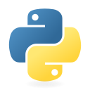
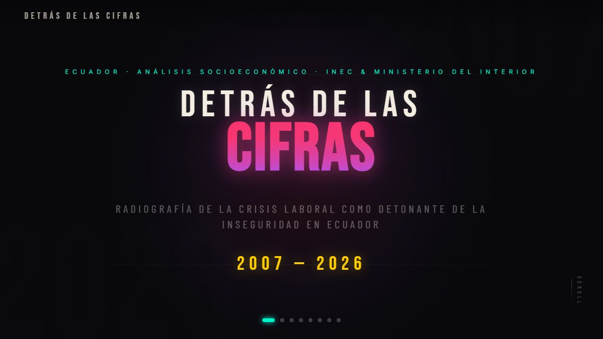
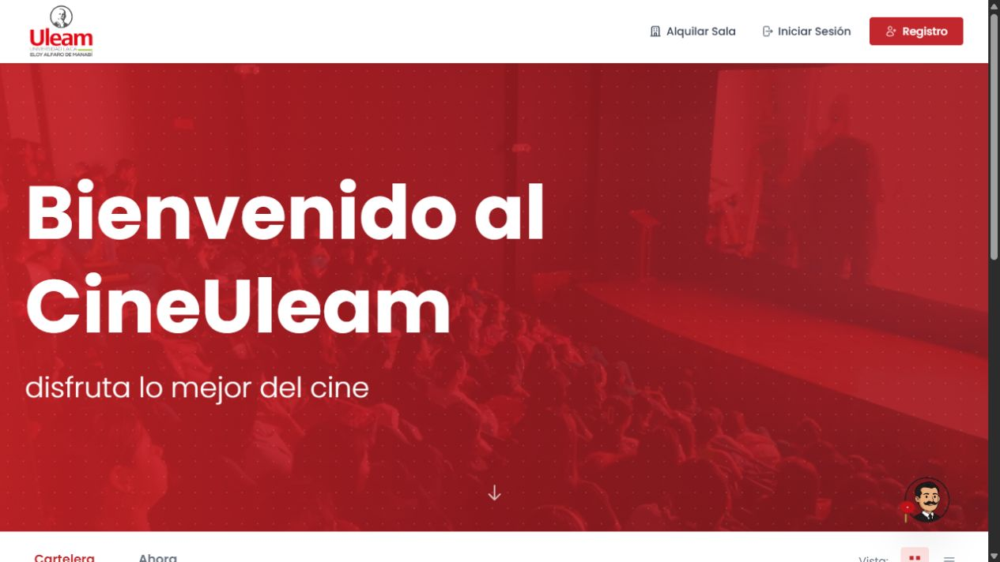
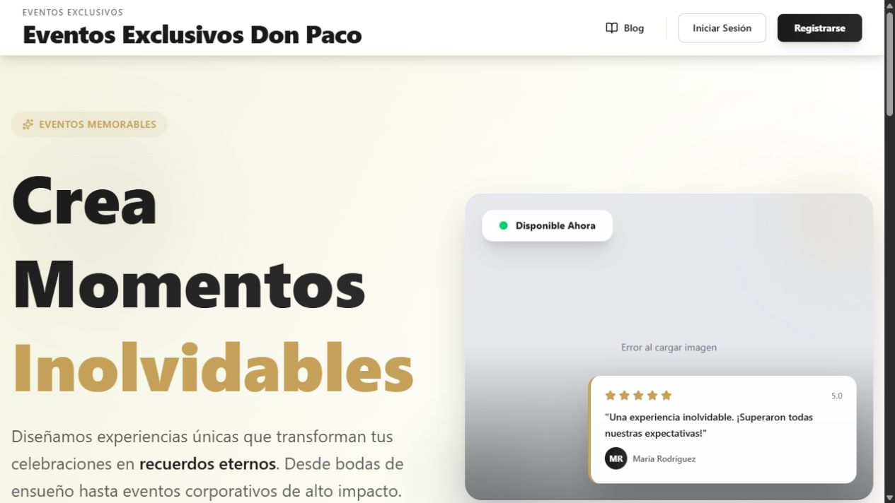

# Carlos Valencia

### Desarrollo full stack · Ingeniería de Software

Conecto interfaces, lógica y datos para convertir ideas en soluciones tecnológicas.

**Manta, Ecuador** · **ULEAM** · **7.º semestre**

[LinkedIn](https://www.linkedin.com/in/carlos-valencia-788a65312/) &nbsp; · &nbsp; [Mi portafolio](https://github.com/CarlosValencia007/Portafolio) &nbsp; · &nbsp; [Proyectos](#proyectos-destacados)

---

## Sobre mí

Soy **Carlos Adrian Valencia Mendoza**, estudiante de Ingeniería de Software en la **Universidad Laica Eloy Alfaro de Manabí**. Me apasiona construir soluciones útiles y entender cómo se conectan las distintas partes de una aplicación.

Mi enfoque es **full stack**. Me interesa seguir explorando la **inteligencia artificial y la automatización** como herramientas para resolver problemas reales.

## Tecnologías

### Frontend

   &nbsp;
   &nbsp;
   &nbsp;
  

TypeScript · Angular · React · Vue

### Backend

   &nbsp;
   &nbsp;
  

Python · PHP · Laravel

### Datos

  

SQL · PostgreSQL en el proyecto de Eventos

---

## Proyectos destacados

**Desarrollo en equipo:** participación compartida en las distintas partes de cada proyecto.

<strong>Detrás de las Cifras</strong> · Visualización de datos

 

Exploración de datos socioeconómicos de Ecuador a través de gráficos interactivos y una narrativa al desplazarse por la página. Presentado en una casa abierta.

**Enfoque:** visualización de datos · ApexCharts · narrativa interactiva.

[Explorar demo](https://visualizacion-casa-abierta.vercel.app/)

<strong>Cine ULEAM</strong> · Hackatón

 

Plataforma de cine universitario desarrollada durante una hackatón, con interfaz de cartelera y acceso al alquiler de salas para eventos.

**Tecnologías:** Vue · TypeScript · Supabase.

[Explorar demo](https://cine-uleam-hackaton.vercel.app/) · [Repositorio del equipo](https://github.com/Noobex1608/CineUleamHackaton)

<strong>Eventos Exclusivos</strong> · Aplicación full stack

 

Plataforma para gestión y reserva de eventos, que conecta una experiencia web con servicios de backend y persistencia de datos.

**Tecnologías:** Vue · TypeScript · NestJS · PostgreSQL.

[Explorar demo](https://eventos-frontend-pb4i.onrender.com/) · Repositorio privado.

## Experiencia

### Hotel Wyndham Sail Plaza Manta

**Prácticas preprofesionales I · Área de Sistemas**

192 horas · Del 4 de agosto al 11 de septiembre de 2026.

## Formación complementaria

<strong>Desarrollo web, IA, seguridad y sistemas</strong> · Ver cursos

- **Programación Web** — curso aprobado de 60 horas · Abril de 2026.
- **Transformación Digital con IA y Automatización** — módulo aprobado de 150 horas, Academia Desafío Latam · Diciembre de 2025.
- **Foundations of Cybersecurity** — curso de Google en Coursera · Marzo de 2026. [Ver credencial](https://coursera.org/verify/E5DQGX1COST5).
- **NDG Linux Unhatched** — NDG, a través de Cisco Networking Academy · Julio de 2024.

## Idiomas

**Español:** nativo &nbsp; · &nbsp; **Inglés:** B1

---

**¿Conectamos?**

[LinkedIn](https://www.linkedin.com/in/carlos-valencia-788a65312/) &nbsp; · &nbsp; [Código de mi portafolio](https://github.com/CarlosValencia007/Portafolio)

Iconos de tecnologías: <a href="https://github.com/devicons/devicon">Devicon</a> · <a href="assets/icons/LICENSE">Licencia MIT</a>.

